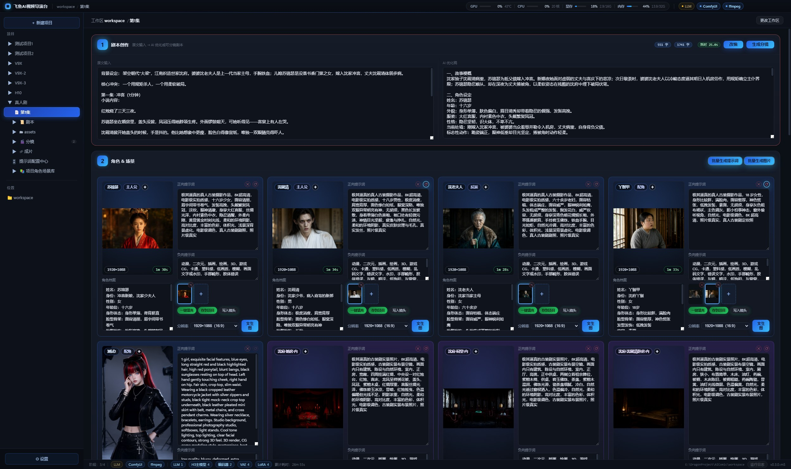
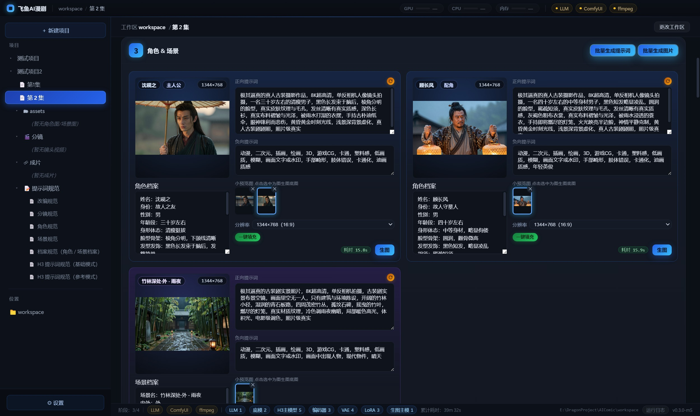
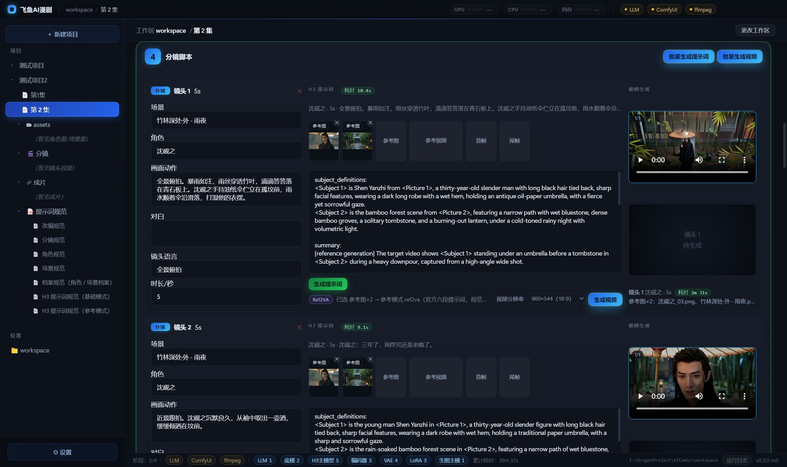
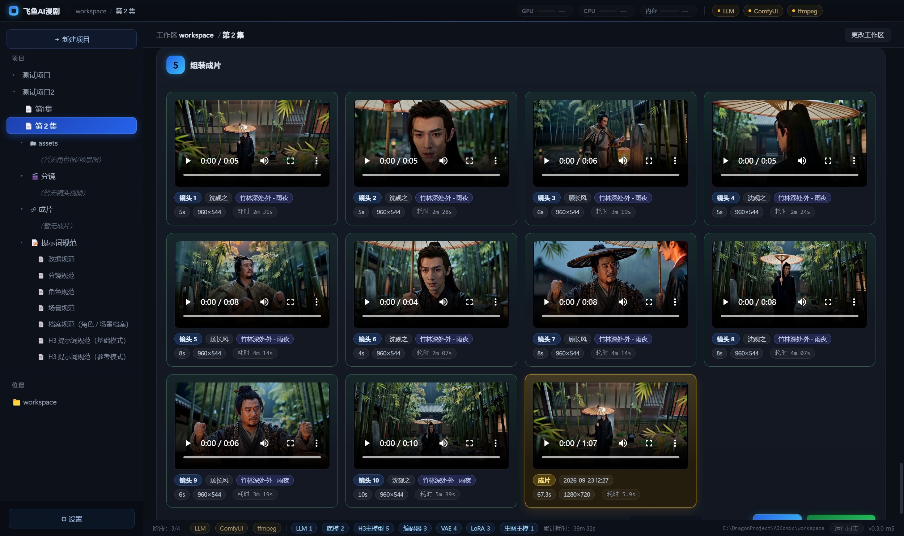

# 飞鱼AI视频导演台

把小说、故事一键变成漫剧 / 短剧视频的本地软件：**改编 → 角色场景 → 分镜出视频 → 组装成片**。
另外还有一个独立的**图片生成**工作台（文生图 / 图片编辑 / 图生图），不建项目也能直接用。
全程在你自己的电脑上完成，创作内容不上传、不外泄。

**它能做什么**

| 模块 | 干什么 |
|---|---|
| 剧本改编 | 小说 / 故事 → 分集大纲 → 逐集剧本对白 |
| 角色 & 场景 | 角色卡、场景板、装扮变体，保证同一角色跨镜不换脸 |
| 分镜脚本 | 逐镜出首尾帧 → H3 出视频（首尾帧 / 参考图两条支路），集级光线与声音基调统一 |
| 组装成片 | 字幕、BGM、逐镜响度归一，一键导出成片 |
| 图片生成 | 文生图 / 图片编辑 / 图生图，参考图最多 10 张；参考图可一键**反推提示词** |

**安装只要三步，照着做就行：**

| 步骤 | 做什么 | 去哪看 |
|---|---|---|
| 第一步 | 装**本软件** | 见下方「第一步」 |
| 第二步 | 装 **ComfyUI**（出图 / 出视频的后端） | 见下方「第二步」 |
| 第三步 | 下载**模型文件**（约 93GB） | 见下方「第三步」 |

三步缺一不可，请按顺序做完，就可以开始创作了。

---

## 第一步：安装本软件

两种方式，**任选一种**。

### 方式一：一键安装包（推荐，最省事）

下载安装包（`.exe`，约 720MB），双击 → 选个安装目录 → 装好即可。

> 下载地址：网盘「飞鱼AI视频工作台」
> 链接：<https://pan.baidu.com/s/1CE3ORRK3orUWClK0pR0HEg?pwd=xmbn>
> 提取码：**xmbn**

### 方式二：源码运行（适合会写代码的用户）

按顺序执行下面 4 条命令：

```bash
git clone https://github.com/ppzflpp/aicomic.git
cd aicomic/comic-studio
npm install
npm run dev
```

另外还要从上面同一个网盘下载 **`tools` 文件夹**，整个放进 `comic-studio/` 目录里，和 `electron/`、`src/` 放在一起：

```
comic-studio/
  ├── tools/          ← 从网盘下载后放这里
  ├── electron/
  └── src/
```

---

## 第二步：安装 ComfyUI（必须装）

⚠️ 出图、出视频都是 ComfyUI 在干活。**不管用上面哪种方式装软件，都必须再装一个 ComfyUI**，否则什么图都出不了。

> ⚠️ **必须按下面的顺序做。** ComfyUI 装完只是有了程序，**还要创建一个实例**——本软件把配套节点装进实例里，没有实例就没地方装，出图会报「节点不存在」。

1. 打开官网下载并安装：[comfy.org/download](https://www.comfy.org/download)（版本要 **0.37.0 以上**）
2. 装好后打开 ComfyUI，**新建并启动一个实例**
   名字随便起（比如「飞鱼AI」），**已经有实例的直接用，不用再建一个**
3. 实例启动起来、确认能进界面后，**把 ComfyUI 关掉**
   （下一步要往实例里装节点，关着装、装完再启动，才不会白装一次）
4. 打开本软件 → 设置 → 模型管家 → 点 **「选择 ComfyUI 安装目录…」**
   - 选 **`Comfy Desktop.exe` 所在的文件夹**（一般是 `…\Comfy Desktop`）
   - 或选 **`…\ComfyUI-Installs\<实例名>\ComfyUI`**（含 `main.py` 的那一层）
   - **不要**选到 `models`，也不要选工作区目录
5. 看到**绿色「节点已就绪」**就说明装好了
   （ComfyUI 关着时显示「节点已置备 · 启动后生效」，效果一样）
6. **手动启动 ComfyUI**（或让本软件启动它），然后就可以开始创作了

> 每次使用本软件之前，都要先启动一次 ComfyUI。
> ComfyUI 版本只在它启动后检测——没启动时显示「请先启动 ComfyUI 实例」，启动后几秒内自动变成真实版本，**不会读到别的实例的版本**。
> 如果节点徽标是黄色「已装好 · 需重启 ComfyUI」，把 ComfyUI 关掉再打开一次即可。
> 忘了建实例？软件会在模型管家里直接提示，不会让你反复重选目录。

---

## 第三步：下载模型（必须自己下载）

下面这些文件，**软件里没有、网盘里也没有，必须自己下载**，合计约 93GB（非 50 系显卡约 108GB）。
全部是 [hf-mirror.com](https://hf-mirror.com) 的国内镜像，点开就能下，不用科学上网。

**下面三组的文件都要下齐。**

### 1️⃣ 文字创作（2 个）

| 文件 | 大小 | 下载 |
|---|---|---|
| Qwen3.5-9B-Q5_K_M.gguf | 6.1GB | [下载](https://hf-mirror.com/unsloth/Qwen3.5-9B-GGUF/resolve/main/Qwen3.5-9B-Q5_K_M.gguf) |
| mmproj-F16.gguf | 0.9GB | [下载](https://hf-mirror.com/unsloth/Qwen3.5-9B-GGUF/resolve/main/mmproj-F16.gguf) |

> 第二个是**视觉投影器**，装了它图片才能被「读懂」——图片生成页的**反推提示词**靠它工作。
> 没有它，改编、分镜、图片生成都照常用，只是点「反推提示词」会提示找不到视觉投影器。
> 两个文件必须放在**同一个目录**（用模型管家批量导入就不用管，它会自动放对位置）。

### 2️⃣ 生图（3 个）

| 文件 | 大小 | 下载 |
|---|---|---|
| qwen_image_2.1_int8_convrot.safetensors | 7.3GB | [下载](https://hf-mirror.com/Comfy-Org/Qwen-Image-2.1/resolve/main/diffusion_models/qwen_image_2.1_int8_convrot.safetensors) |
| qwen3vl_8b_int8_convrot.safetensors | 9.4GB | [下载](https://hf-mirror.com/Comfy-Org/Qwen-Image-2.1/resolve/main/text_encoders/qwen3vl_8b_int8_convrot.safetensors) |
| qwen_image_2.1_vae_bf16.safetensors | 0.7GB | [下载](https://hf-mirror.com/Comfy-Org/Qwen-Image-2.1/resolve/main/vae/qwen_image_2.1_vae_bf16.safetensors) |

### 3️⃣ 出视频（下面四组全要）

**① 视频主模型（2 个）**

| 文件 | 大小 | 下载 |
|---|---|---|
| minimax_h3_fl2va_pruned_int8_convrot.safetensors | 21GB | [下载](https://hf-mirror.com/Comfy-Org/MiniMax-H3/resolve/main/diffusion_models/minimax_h3_fl2va_pruned_int8_convrot.safetensors) |
| minimax_h3_ref2va_pruned_int8_convrot.safetensors | 21GB | [下载](https://hf-mirror.com/Comfy-Org/MiniMax-H3/resolve/main/diffusion_models/minimax_h3_ref2va_pruned_int8_convrot.safetensors) |

**② 视频文字编码器（看你的显卡，两个里选一个）**

| 文件 | 大小 | 下载 |
|---|---|---|
| qwen3vl_32b_minimax_h3_nvfp4_awq.safetensors<br><sub>**50 系显卡选这个**</sub> | 15.7GB | [下载](https://hf-mirror.com/Comfy-Org/MiniMax-H3/resolve/main/text_encoders/qwen3vl_32b_minimax_h3_nvfp4_awq.safetensors) |
| qwen3vl_32b_minimax_h3_int8_convrot.safetensors<br><sub>**非 50 系显卡选这个**</sub> | 27.1GB | [下载](https://hf-mirror.com/Comfy-Org/MiniMax-H3/resolve/main/text_encoders/qwen3vl_32b_minimax_h3_int8_convrot.safetensors) |

> 怎么看自己是不是 50 系？显卡型号以 **RTX 50** 开头就是（比如 RTX 5060 / 5070 / 5080 / 5090）。
> 选错了软件会跑不起来，请对着自己的显卡型号下。

**③ 出片加速包（5 个，都要下）**

| 文件 | 大小 | 下载 |
|---|---|---|
| minimax_h3_fl2v_turbo_4step_v1.0_768p_comfyui_bf16.safetensors | 2.0GB | [下载](https://hf-mirror.com/Comfy-Org/MiniMax-H3/resolve/main/loras/minimax_h3_fl2v_turbo_4step_v1.0_768p_comfyui_bf16.safetensors) |
| minimax_h3_ref2v_turbo_4step_v0.1_comfyui_bf16.safetensors | 2.0GB | [下载](https://hf-mirror.com/Comfy-Org/MiniMax-H3/resolve/main/loras/minimax_h3_ref2v_turbo_4step_v0.1_comfyui_bf16.safetensors) |
| minimax_h3_fl2v_turbo_8step_v1.0_768p_comfyui_bf16.safetensors | 2.0GB | [下载](https://hf-mirror.com/lightx2v/Minimax-h3-Turbo/resolve/main/minimax_h3_fl2v_turbo_8step_v1.0_768p_comfyui_bf16.safetensors) |
| minimax_h3_fl2v_turbo_8step_v1.0_comfyui_bf16.safetensors | 2.0GB | [下载](https://hf-mirror.com/lightx2v/Minimax-h3-Turbo/resolve/main/minimax_h3_fl2v_turbo_8step_v1.0_comfyui_bf16.safetensors) |
| minimax_h3_ref2v_turbo_8step_v1.0_768p_comfyui_bf16.safetensors | 2.0GB | [下载](https://hf-mirror.com/lightx2v/Minimax-h3-Turbo/resolve/main/minimax_h3_ref2v_turbo_8step_v1.0_768p_comfyui_bf16.safetensors) |

> 5 个都要下，少一个出片画面会变差。

**④ 视频画面与声音解码（2 个）**

| 文件 | 大小 | 下载 |
|---|---|---|
| minimax_h3_video_vae_fp16.safetensors | 5.2GB | [下载](https://hf-mirror.com/Comfy-Org/MiniMax-H3/resolve/main/vae/minimax_h3_video_vae_fp16.safetensors) |
| minimax_h3_audio_vae_fp32.safetensors | 0.6GB | [下载](https://hf-mirror.com/Comfy-Org/MiniMax-H3/resolve/main/vae/minimax_h3_audio_vae_fp32.safetensors) |

---

**下载完不用自己分类、也不用找地方放。** 打开本软件 →「设置 → 模型管家」→ 点「批量导入文件夹…」，
选中你下载文件所在的文件夹，软件会自动识别并存到正确位置。**列表里全部显示绿色，就说明装好了。**

模型管家还会显示 **ComfyUI 装在哪儿、它实际读取的模型目录**。如果两边指向的不是同一个地方
（软件看得见、ComfyUI 看不见），这里会标红，点一下「让 ComfyUI 读取此目录」即可对齐，
重启 ComfyUI 后生效 —— 生成前软件也会先核对一遍，缺哪个文件会直接说清楚，不会白跑一轮。

---

## 全部装好后：开始创作

1. 先打开 **ComfyUI**，在里面启动一个实例，然后最小化放着
2. 打开**飞鱼AI视频导演台** → 左上角「设置 → 模型管家」→ 批量导入模型文件夹，确认全部变绿
3. 回到主界面 → 点**新建项目**：先选「视频质量」和「视频比例」，软件会自动填好各项分辨率（也可以自己改）
4. 选好项目文件夹，就可以开始创作了

顶部状态条会显示文字模型、ComfyUI、ffmpeg 有没有就绪，以及显卡 / 内存占用，一眼就能看出环境是否正常。

> 文字创作、出图、出视频需要用到时，软件会自动启动对应的服务，不用你手动开关。

### 只想先出几张图？

左侧 **「图片生成」** 是独立工作台，不用建项目、不用先跑剧本，选好分辨率直接就能出图：

- **不传图** = 文生图；**传了图** = 以图为准重绘；再勾上「**编辑图片**」= 按你的文字指令改这张图；
- 参考图最多 10 张，提示词里用「图1 / 图2 / 图3」引用（页面里有示例可一键填入）；
- 每张参考图下方都有 **「反推提示词」**：点一下，软件用本地大模型读这张图，自动写出画面描述填进提示词框——反推完直接点生成，就得到同风格的图；
- 出图结果会保留分辨率与生成耗时，点图即可放大查看，历史记录按日期归档在 `图片生成\<日期>\` 下。

**软件界面预览：**

| 剧本改编 | 角色 & 场景 |
|---|---|
|  |  |
| **分镜脚本** | **组装成片** |
|  |  |

---

## 我的显卡够不够？

| 显存 | 情况 |
|---|---|
| 8-12GB | 出图没问题；出视频建议把分辨率调低一些 |
| 16GB 以上 | 出图、出视频都很顺畅 |

> 出视频要装哪个文件，按你的显卡选（见上方「第三步 ②」）：**50 系显卡选 nvfp4，非 50 系选 int8**。

---

## 最近更新（v0.3.1）

- **首次出图不再报「节点不存在」**：安装包自带配套自定义节点，**选好 ComfyUI 目录就立刻装进实例的 `custom_nodes`**（幂等，不重复写盘）；机器上装了多个实例时每个各装一份，用户自己双击启动 ComfyUI 也能命中
- **没建实例会直接说**：ComfyUI Desktop 装了但一个实例都没创建时，模型管家显示「请先创建 ComfyUI 实例」并给出动作，不会让用户反复重选目录；实例名不参与判断，叫什么都行
- **「模型管家」只剩一个动作**：点「选择 ComfyUI 安装目录…」选 ComfyUI 装在哪，models 由软件自动识别；选错会一行红字直接告诉你（不再出现「模型管家改的乱七八糟」的说明墙）
- **ComfyUI 版本检测**：只在 ComfyUI **启动后**检测（运行中的实例自报，最准；磁盘上有多个实例也不会误报）。未启动时显示「请先启动 ComfyUI 实例」，启动后 6 秒内自动变成真实版本。低于 **v0.37.0** 会提示「运行软件会出错」并给「去下载」入口；说明与体检明细默认收起，主界面只剩两行
- **前置要求**：ComfyUI 需 **≥ v0.37.0**（工作流用的 `TextEncodeQwenImage21` 从这一版才有）；装好节点后需重启一次 ComfyUI 才生效
- ⚠️ 大模型文件仍需自己下载（见「第三步 ②」），安装包不包含

## 最近更新（v0.3.0）

- **新增「图片生成」工作台**：Qwen-Image 2.1 文生图 / 图片编辑 / 图生图三合一，最多 10 张参考图；所选分辨率严格生效（以前编辑通道会按参考图比例跑偏）
- **新增「提示词反推」**：参考图下方常驻按钮，点一下用本地大模型读图并自动填入提示词；图片不出本机
- **分镜更连贯**：新增「集级设定」（光线基调 / 轴线铁律 / 声音基底 / 禁止项），逐镜自动拼进提示词；场景加了「主光」「环境音」
- **成片音量更稳**：导出前逐镜响度归一，同一集里镜头之间的音量落差从近 20dB 压到 3dB 左右
- **界面**：左侧栏可收起；「图片生成」与工作台平级；切到别的菜单不会再中断正在出图的任务
- ⚠️ 反推提示词需要额外下载 **mmproj-F16.gguf**（见「第三步 1️⃣」）

> 升级方式：下载新版安装包**覆盖安装**即可，项目文件、模型和历史记录都不会动。

---

## 交流

QQ 群：**1036028422** — 使用中有问题欢迎进群讨论。

## 打赏

开源不易，从改编、出图到成片的每一步都是用爱发电。
如果这个软件帮你把小说、故事变成了视频，省下了真金白银的制作费，欢迎请作者喝杯咖啡 ☕
金额随意，心意最重要 —— 你的支持就是我继续更新的动力！

**打赏方式**：扫描下方二维码添加作者微信，备注「飞鱼」，添加后微信转账即可。

<p align="center"></p>

## License

随意使用，可商用。如果觉得好用，欢迎回来点个 Star 或请作者喝杯咖啡。
