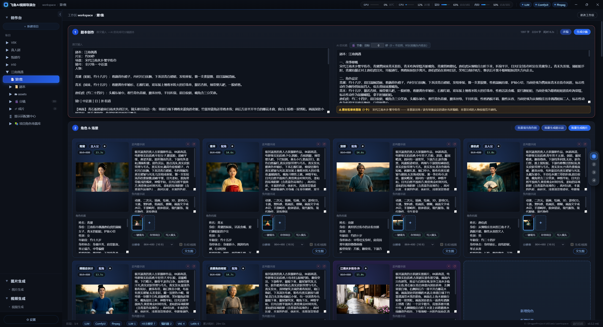
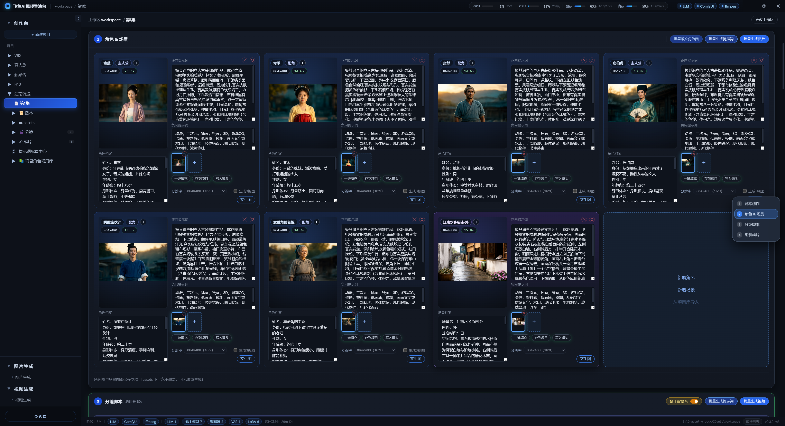
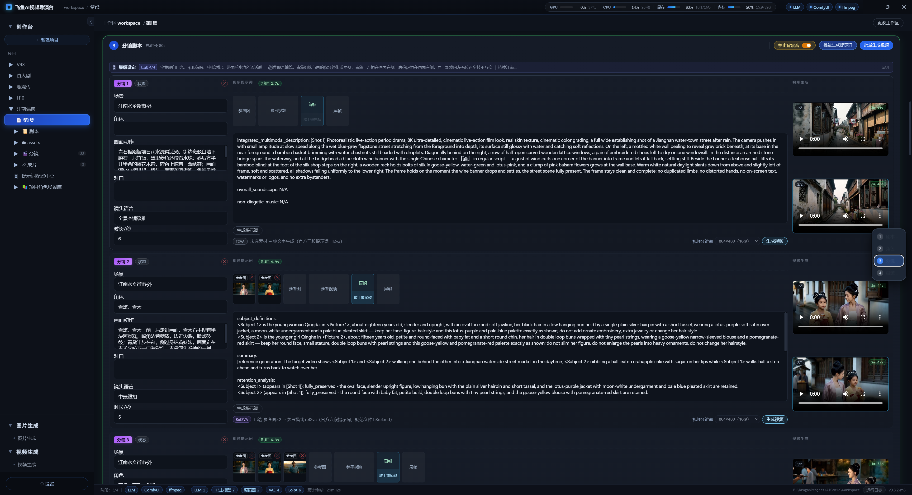
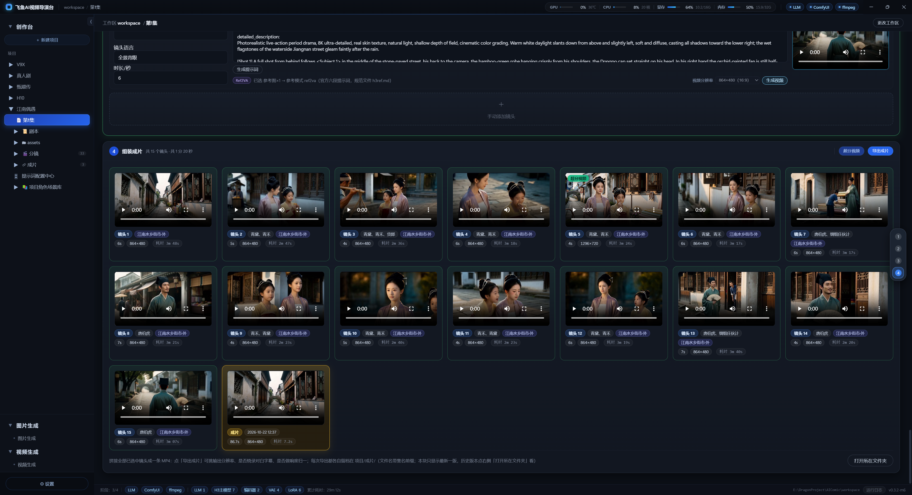
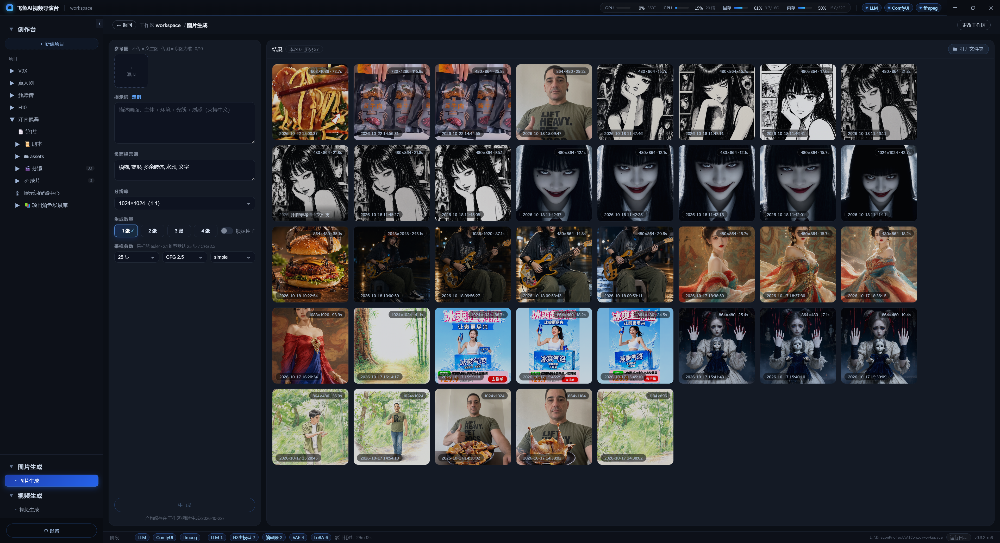
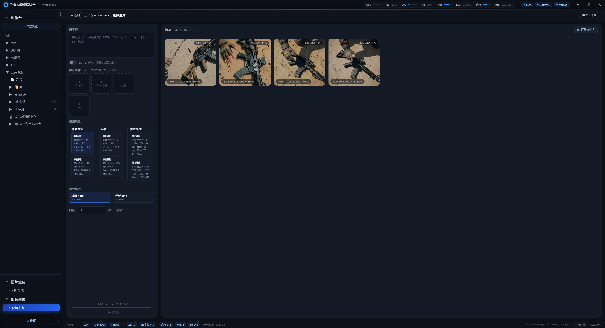
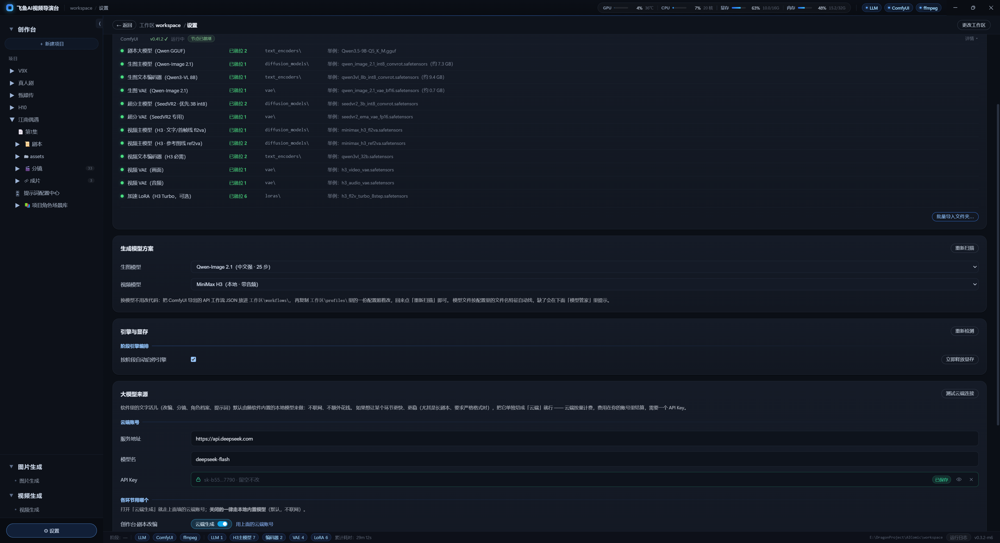

# 飞鱼AI视频导演台

> 🎉 **本项目代码已开源！** 如果有特殊需求（定制功能、私有化部署、二次开发等），欢迎加作者微信 **`ppzflpp`** 沟通定制。

把小说、故事一键变成漫剧 / 短剧视频的本地软件：**改编 → 角色场景 → 分镜出视频 → 组装成片**。
另外还有独立的**图片生成**、**视频生成**两个工作台，不建项目也能直接用。
全程在你自己的电脑上完成，创作内容不上传、不外泄。

**它能做什么**

| 模块 | 干什么 |
|---|---|
| 剧本改编 | 小说 / 故事 → 分集大纲 → 逐集剧本对白 |
| 角色 & 场景 | 角色卡、场景板、装扮变体，保证同一角色跨镜不换脸 |
| 分镜脚本 | 逐镜出首尾帧 → H3 出视频（首尾帧 / 参考图两条支路），列表 / **网格视图**切换，集级光线与声音基调统一 |
| 组装成片 | **片头封面**、字幕、BGM、逐镜响度归一，**视频超分**放大一档，一键导出成片 |
| 图片生成 | 文生图 / 图片编辑 / 图生图，参考图最多 10 张；参考图可一键**反推提示词**；可选**基础模型 / 加速 LoRA / 风格 LoRA**，采样参数随档位自动锁定；风格 LoRA 丢进目录就能用，**自动适配 PEFT 格式、自动读取触发词、自动识别底模架构** |
| 视频生成 | 文生视频 / 首尾帧生视频 / 参考图·参考视频生视频，自动判定模式，可一键转**白膜视频**；可选**动作 / 交互 LoRA**（放目录即可用）；生成后可**回填配置**、**重写提示词** |

**安装只要三步，照着做就行：**

| 步骤 | 做什么 | 去哪看 |
|---|---|---|
| 第一步 | 装**本软件** | 见下方「第一步」 |
| 第二步 | 装 **ComfyUI**（出图 / 出视频的后端） | 见下方「第二步」 |
| 第三步 | 下载**模型文件**（约 93GB） | 见下方「第三步」 |

三步缺一不可，请按顺序做完，就可以开始创作了。

> 装好之后，软件**左侧菜单最底部有一个「? 帮助」**：里面是同样的步骤，但会读取你电脑的真实状态 —— 模型目录设对没有、四个必需文件还缺哪几个、风格 LoRA 认出几个，一眼就能看出差什么。

---

## 第一步：安装本软件

两种方式，**任选一种**。

### 方式一：一键安装包（推荐，最省事）

下载安装包（`.exe`，约 750MB），双击 → 选个安装目录 → 装好即可。

> 下载地址：网盘「飞鱼AI视频工作台」
> 链接：<https://pan.baidu.com/s/1CE3ORRK3orUWClK0pR0HEg?pwd=xmbn>
> 提取码：**xmbn**

### 方式二：源码运行（适合会写代码的用户）

按顺序执行下面 4 条命令：

```bash
git clone https://github.com/ppzflpp/aicomic.git
cd aicomic/comic-studio
npm install
npm run dev
```

另外还要从上面同一个网盘下载 **`tools` 文件夹**，整个放进 `comic-studio/` 目录里，和 `electron/`、`src/` 放在一起：

```
comic-studio/
  ├── tools/          ← 从网盘下载后放这里
  ├── electron/
  └── src/
```

---

## 第二步：安装 ComfyUI（必须装）

⚠️ 出图、出视频都是 ComfyUI 在干活。**不管用上面哪种方式装软件，都必须再装一个 ComfyUI**，否则什么图都出不了。

> ⚠️ **必须按下面的顺序做。** ComfyUI 装完只是有了程序，**还要创建一个实例**——本软件把配套节点装进实例里，没有实例就没地方装，出图会报「节点不存在」。

1. 打开官网下载并安装：[comfy.org/download](https://www.comfy.org/download)（版本要 **0.37.0 以上**）
2. 装好后打开 ComfyUI，**新建并启动一个实例**
   名字随便起（比如「飞鱼AI」），**已经有实例的直接用，不用再建一个**
3. 实例启动起来、确认能进界面后，**把 ComfyUI 关掉**
   （下一步要往实例里装节点，关着装、装完再启动，才不会白装一次）
4. 打开本软件 → 设置 → 模型管家 → 点 **「选择 ComfyUI 安装目录…」**
   - 选 **`Comfy Desktop.exe` 所在的文件夹**（一般是 `…\Comfy Desktop`）
   - 或选 **`…\ComfyUI-Installs\<实例名>\ComfyUI`**（含 `main.py` 的那一层）
   - **不要**选到 `models`，也不要选工作区目录
5. 看到**绿色「节点已就绪」**就说明装好了
   （ComfyUI 关着时显示「节点已置备 · 启动后生效」，效果一样）
6. **手动启动 ComfyUI**（或让本软件启动它），然后就可以开始创作了

> 每次使用本软件之前，都要先启动一次 ComfyUI。
> ComfyUI 版本只在它启动后检测——没启动时显示「请先启动 ComfyUI 实例」，启动后几秒内自动变成真实版本，**不会读到别的实例的版本**。
> 如果节点徽标是黄色「已装好 · 需重启 ComfyUI」，把 ComfyUI 关掉再打开一次即可。
> 忘了建实例？软件会在模型管家里直接提示，不会让你反复重选目录。

---

## 第三步：下载模型（必须自己下载）

下面这些文件，**软件里没有、网盘里也没有，必须自己下载**，合计约 93GB（非 50 系显卡约 108GB）。
大部分走 [hf-mirror.com](https://hf-mirror.com) 国内镜像（B 方案的原始模型走 [modelscope.cn](https://www.modelscope.cn)），点开就能下，不用科学上网。

**下面 1️⃣～3️⃣ 三组的文件都要下齐；4️⃣ 是可选（要超分才下）。**
**标「①′ / ③′」的是 B 方案专用（16G 以上显存才要），用小显存 A 方案就不用下。**

### 1️⃣ 文字创作（2 个）

| 文件 | 大小 | 下载 |
|---|---|---|
| Qwen3.5-9B-Q5_K_M.gguf | 6.1GB | [下载](https://hf-mirror.com/unsloth/Qwen3.5-9B-GGUF/resolve/main/Qwen3.5-9B-Q5_K_M.gguf) |
| mmproj-F16.gguf | 0.9GB | [下载](https://hf-mirror.com/unsloth/Qwen3.5-9B-GGUF/resolve/main/mmproj-F16.gguf) |

> 第二个是**视觉投影器**，装了它图片才能被「读懂」——图片生成页的**反推提示词**靠它工作。
> 没有它，改编、分镜、图片生成都照常用，只是点「反推提示词」会提示找不到视觉投影器。
> 两个文件必须放在**同一个目录**（用模型管家批量导入就不用管，它会自动放对位置）。

### 2️⃣ 生图（3 个）

| 文件 | 大小 | 下载 |
|---|---|---|
| qwen_image_2.1_int8_convrot.safetensors | 7.3GB | [下载](https://hf-mirror.com/Comfy-Org/Qwen-Image-2.1/resolve/main/diffusion_models/qwen_image_2.1_int8_convrot.safetensors) |
| qwen3vl_8b_int8_convrot.safetensors | 9.4GB | [下载](https://hf-mirror.com/Comfy-Org/Qwen-Image-2.1/resolve/main/text_encoders/qwen3vl_8b_int8_convrot.safetensors) |
| qwen_image_2.1_vae_bf16.safetensors | 0.7GB | [下载](https://hf-mirror.com/Comfy-Org/Qwen-Image-2.1/resolve/main/vae/qwen_image_2.1_vae_bf16.safetensors) |

### 3️⃣ 出视频（下面四组全要）

**① 视频主模型（2 个，都要下）**

| 文件 | 大小 | 下载 |
|---|---|---|
| minimax_h3_fl2va_pruned_int8_convrot.safetensors | 21GB | [下载](https://hf-mirror.com/Comfy-Org/MiniMax-H3/resolve/main/diffusion_models/minimax_h3_fl2va_pruned_int8_convrot.safetensors) |
| minimax_h3_ref2va_pruned_int8_convrot.safetensors | 21GB | [下载](https://hf-mirror.com/Comfy-Org/MiniMax-H3/resolve/main/diffusion_models/minimax_h3_ref2va_pruned_int8_convrot.safetensors) |

**①′ 原始版主模型（可选，2 个，只有用「B 方案」才要）**

上面两个是**剪枝版**（A 方案用）。如果你显存 16G 以上、想用质量更好的 **B 方案**（原始模型 + PDD 加速），还要再下这两个**原始版**（文生/首尾帧、参考图各一个）：

| 文件 | 大小 | 下载 |
|---|---|---|
| minimax_h3_fl2va_int8_convrot.safetensors | 31.7GB | [下载](https://www.modelscope.cn/models/Comfy-Org/MiniMax-H3/resolve/master/diffusion_models/minimax_h3_fl2va_int8_convrot.safetensors) |
| minimax_h3_ref2va_int8_convrot.safetensors | 31.7GB | [下载](https://www.modelscope.cn/models/Comfy-Org/MiniMax-H3/resolve/master/diffusion_models/minimax_h3_ref2va_int8_convrot.safetensors) |

> 不用 B 方案（16G 以下显存、用剪枝版 A 方案）就不用下这两个，省 63.4GB。

**② 视频文字编码器（看你的显卡，两个里选一个）**

| 文件 | 大小 | 下载 |
|---|---|---|
| qwen3vl_32b_minimax_h3_nvfp4_awq.safetensors<br><sub>**50 系显卡选这个**</sub> | 15.7GB | [下载](https://hf-mirror.com/Comfy-Org/MiniMax-H3/resolve/main/text_encoders/qwen3vl_32b_minimax_h3_nvfp4_awq.safetensors) |
| qwen3vl_32b_minimax_h3_int8_convrot.safetensors<br><sub>**非 50 系显卡选这个**</sub> | 27.1GB | [下载](https://hf-mirror.com/Comfy-Org/MiniMax-H3/resolve/main/text_encoders/qwen3vl_32b_minimax_h3_int8_convrot.safetensors) |

> 怎么看自己是不是 50 系？显卡型号以 **RTX 50** 开头就是（比如 RTX 5060 / 5070 / 5080 / 5090）。
> 选错了软件会跑不起来，请对着自己的显卡型号下。

**③ 出片加速包（5 个，都要下）**

| 文件 | 大小 | 下载 |
|---|---|---|
| minimax_h3_fl2v_turbo_4step_v1.0_768p_comfyui_bf16.safetensors | 2.0GB | [下载](https://hf-mirror.com/Comfy-Org/MiniMax-H3/resolve/main/loras/minimax_h3_fl2v_turbo_4step_v1.0_768p_comfyui_bf16.safetensors) |
| minimax_h3_ref2v_turbo_4step_v0.1_comfyui_bf16.safetensors | 2.0GB | [下载](https://hf-mirror.com/Comfy-Org/MiniMax-H3/resolve/main/loras/minimax_h3_ref2v_turbo_4step_v0.1_comfyui_bf16.safetensors) |
| minimax_h3_fl2v_turbo_8step_v1.0_768p_comfyui_bf16.safetensors | 2.0GB | [下载](https://hf-mirror.com/lightx2v/Minimax-h3-Turbo/resolve/main/minimax_h3_fl2v_turbo_8step_v1.0_768p_comfyui_bf16.safetensors) |
| minimax_h3_fl2v_turbo_8step_v1.0_comfyui_bf16.safetensors | 2.0GB | [下载](https://hf-mirror.com/lightx2v/Minimax-h3-Turbo/resolve/main/minimax_h3_fl2v_turbo_8step_v1.0_comfyui_bf16.safetensors) |
| minimax_h3_ref2v_turbo_8step_v1.0_768p_comfyui_bf16.safetensors | 2.0GB | [下载](https://hf-mirror.com/lightx2v/Minimax-h3-Turbo/resolve/main/minimax_h3_ref2v_turbo_8step_v1.0_768p_comfyui_bf16.safetensors) |

> 5 个都要下，少一个出片画面会变差。

**③′ PDD 加速 LoRA（可选，2 个，只有用「B 方案」才要）**

上面 5 个 turbo LoRA 是**剪枝版 A 方案**用的。如果你想用 **B 方案**（原始模型 + PDD 加速，16G 以上显存推荐），还要再下这两个 PDD LoRA（文生/首尾帧、参考图各一个）：

| 文件 | 大小 | 下载 |
|---|---|---|
| minimax_h3_ref2va_pdd_8step_adaln2688_comfy.safetensors | 1.6GB | [下载](https://hf-mirror.com/fbjr/MiniMax-H3-Acc-LoRAs-sidecar/resolve/main/minimax_h3_ref2va_pdd_8step_adaln2688_comfy.safetensors) |
| minimax_h3_fl2va_pdd_8step_adaln2688_comfy.safetensors | 1.6GB | [下载](https://hf-mirror.com/fbjr/MiniMax-H3-Acc-LoRAs-sidecar/resolve/main/minimax_h3_fl2va_pdd_8step_adaln2688_comfy.safetensors) |

> 必须配上面「①′ 原始版主模型」一起用。不用 B 方案就不用下。

**④ 视频画面与声音解码（2 个）**

| 文件 | 大小 | 下载 |
|---|---|---|
| minimax_h3_video_vae_fp16.safetensors | 5.2GB | [下载](https://hf-mirror.com/Comfy-Org/MiniMax-H3/resolve/main/vae/minimax_h3_video_vae_fp16.safetensors) |
| minimax_h3_audio_vae_fp32.safetensors | 0.6GB | [下载](https://hf-mirror.com/Comfy-Org/MiniMax-H3/resolve/main/vae/minimax_h3_audio_vae_fp32.safetensors) |

### 4️⃣ 视频超分（可选，2 个）

只有想在成片阶段把镜头**放大一档、补回细节**才需要。不下也能正常出片、导出成片，只是「超分视频」按钮会提示模型没就位。

| 文件 | 大小 | 下载 |
|---|---|---|
| seedvr2_3b_int8_convrot.safetensors | 3.4GB | [下载](https://hf-mirror.com/Comfy-Org/SeedVR2/resolve/main/diffusion_models/seedvr2_3b_int8_convrot.safetensors) |
| seedvr2_ema_vae_fp16.safetensors | 0.5GB | [下载](https://hf-mirror.com/Comfy-Org/SeedVR2/resolve/main/vae/seedvr2_ema_vae_fp16.safetensors) |

> 走的是 ComfyUI **内置**的超分节点，不用装任何插件。
> 超分很吃显存：报显存不足就把倍率从 3 倍降到 2 倍，再不行降到 1.5 倍。
> 耗时参考：**864×480 · 6.6 秒 · 2 倍 ≈ 10 分钟一个镜头**，同长度的 1344×768 约为它的 2～3 倍。

---

**下载完不用自己分类、也不用找地方放。** 打开本软件 →「设置 → 模型管家」→ 点「批量导入文件夹…」，
选中你下载文件所在的文件夹，软件会自动识别并存到正确位置。**列表里全部显示绿色，就说明装好了。**

模型管家还会显示 **ComfyUI 装在哪儿、它实际读取的模型目录**。如果两边指向的不是同一个地方
（软件看得见、ComfyUI 看不见），这里会标红，点一下「让 ComfyUI 读取此目录」即可对齐，
重启 ComfyUI 后生效 —— 生成前软件也会先核对一遍，缺哪个文件会直接说清楚，不会白跑一轮。

---

## 全部装好后：开始创作

1. 先打开 **ComfyUI**，在里面启动一个实例，然后最小化放着
2. 打开**飞鱼AI视频导演台** → 左上角「设置 → 模型管家」→ 批量导入模型文件夹，确认全部变绿
3. 回到主界面 → 点**新建项目**：先选「视频质量」和「视频比例」，软件会自动把对应的画面分辨率标在比例选项上（如「横版 16:9 · 864×480」），不用再单独去填分辨率
4. 选好项目文件夹，就可以开始创作了

顶部状态条会显示文字模型、ComfyUI、ffmpeg 有没有就绪，以及显卡 / 内存占用，一眼就能看出环境是否正常。

> 出完视频后想更清晰：在「组装成片」点 **「超分视频」**，勾选镜头、选好倍率（建议先 2 倍），出来的版本会自动参与成片导出。很吃显存，也慢，可以只挑重点镜头做。

> 想要片头：在「组装成片」标题栏点 **「选封面」**，点「确认」后导出会在正片前插 1 秒封面卡；点「不用封面」随时撤掉。

> 文字创作、出图、出视频需要用到时，软件会自动启动对应的服务，不用你手动开关。

### 只想先出几张图？

左侧 **「图片生成」** 是独立工作台，不用建项目、不用先跑剧本，选好分辨率直接就能出图：

- **不传图** = 文生图；**传了图** = 以图为准重绘；再勾上「**编辑图片**」= 按你的文字指令改这张图；
- 参考图最多 10 张，提示词里用「图1 / 图2 / 图3」引用（页面里有示例可一键填入）；
- 每张参考图下方都有 **「反推提示词」**：点一下，软件用本地大模型读这张图，自动写出画面描述填进提示词框——反推完直接点生成，就得到同风格的图；
- 出图结果会保留分辨率与生成耗时，点图即可放大查看，历史记录按日期归档在 `图片生成\<日期>\` 下。

### 只想先出个视频？

左侧 **「视频生成」** 是独立工作台，不用建项目、不用先跑剧本，上传素材直接就能出视频：

- 填一句文字，或上传**参考图 / 参考视频 / 首帧 / 尾帧**（可自由组合），系统会**自动判定**走哪种模式（文生视频 / 首尾帧 / 参考生视频），不用你选；
- 时长 4~15 秒可填，视频质量沿用创作台的分档方案（另有「**原生 20 步**」档），比例、分辨率一目了然；
- **动作 / 交互 LoRA**：把 H3 的视频权重丢进模型目录的 `loras\h3-action\`，回到这一页刷新就能选。选它**不会锁住任何质量参数** —— 步数、采样器、加速档还是你自己定的；强度单独可调（0.2~1.2），触发词自动读出来并前置拼进提示词，界面上直接显示真正送出的英文原句；不是 H3 训练的权重会提示并禁用生成按钮；
- 点生成后自动进**任务中心**排队，切菜单、切项目都不中断；
- 每次生成会保存一份「配置快照」，结果上悬停即可**回填配置**、**查看提示词**；开启「**提示词重写**」还能按 H3 官方规范自动优化描述；
- 出片结果保留分辨率、视频时长与生成耗时，历史按日期归档在 `视频生成\<日期>\` 下；
- **白膜视频**：打开开关，参考视频里的人 / 物转成 3D 哑光白模 + 纯绿幕；可**保留原始声音**，时长可切「**自动**」跟随参考视频真实长度（超过 15 秒会自动切段生成再拼接，成片按原时长裁尾）。

**软件界面预览：**

| 剧本改编 | 角色 & 场景 |
|---|---|
|  |  |
| **分镜脚本** | **组装成片** |
|  |  |
| **图片生成** | **视频生成** |
|  |  |
| **设置** | |
|  | |

---

## 我的显卡够不够？

| 显存 | 情况 |
|---|---|
| 8-12GB | 出图没问题；出视频建议把分辨率调低一些 |
| 16GB 以上 | 出图、出视频都很顺畅 |

> 出视频要装哪个文件，按你的显卡选（见上方「第三步 ②」）：**50 系显卡选 nvfp4，非 50 系选 int8**。

**视频质量怎么选？** 新建项目里每个质量档都有 **A / B 两个方案**，软件打开时自动识别你显卡的显存，在推荐的那个方案右上角标了金色「推荐」：

- **A 方案**（剪枝模型，16G 以下显存推荐）——更快、更省显存，绝大多数显卡都能顺畅跑；
- **B 方案**（原始模型 + PDD 加速，16G 以上显存推荐）——画质潜力更高、细节更足，适合大显存显卡。

不确定就跟着金色「推荐」走，不会错。挂了动作 / 交互 LoRA 时档位**不会被锁**，想跑多少步就多少步；只想看清 LoRA 本身的效果，选「原生 20 步」即可。

---

## 最近更新（v0.4.2）

- **图片生成可以选模型了**：「基础模型」和「Turbo 8 步」两个档位任选。选了档位之后，**采样参数会自动锁定**成这一档唯一正确的值（步数、CFG、调度器都变灰不可改），不用自己算，也不会因为手改步数把画面跑坏
- **可选加速 LoRA**：基础模型下挂「Turbo LoRA」，8 步出图，速度大约快四倍；只想稳出图就选「不使用」
- **新增风格 LoRA**：把任意 Qwen-Image 的风格权重丢进模型目录的 `loras\qwen-image\`，回到「图片生成」页刷新就会出现。可以**和加速档同时叠加**，强度用输入框调（0.2 ~ 1.0，默认 0.7）
- **风格 LoRA 全自动适配**：不同平台导出的权重格式不一样，软件会自动转成能用的格式再加载。以前遇到这种格式会**静默丢掉近三成权重**，出图还在、效果只剩七成，界面上一点提示都没有；现在你什么都不用做
- **触发词自动读取**：权重文件里写了触发词就直接用，不用手填；同目录放一个同名 `.json` 可以自定义中文名和备注（`xxx.safetensors.json` 和 `xxx.json` 两种写法都认）
- **挂错底模会拦住**：如果选的 LoRA 不是给 Qwen-Image 训练的（比如 Flux / SDXL 的），界面直接提示并禁用生成按钮，不再白等几十秒才发现没效果
- **CFG 提示**：CFG 设为 1.0 时负面提示词不生效，界面会明确提醒你
- **新增「? 帮助」页**：软件内的一页纸说明书，自带**本机体检** —— 模型根目录是否选对、四个必需文件缺哪几个、风格 LoRA 认出几个，一屏看完。还写了模型该放哪个子目录、LoRA 放完为什么要重启才出现、以及「选中了但画面没变化」这类问题怎么判断。不用另找文档，装完软件就能看
- **视频生成支持动作 / 交互 LoRA**：把 H3 视频权重放进模型目录的 `loras\h3-action\`，回到「视频生成」页刷新即可选择。选它**不锁质量档位**，步数、采样器、加速档照你自己选的跑；强度单独可调，触发词自动读取并前置拼接，界面直接显示真正送出的英文原句；不是给 H3 训练的权重（Flux / SDXL 等）会提示并禁用生成按钮
- **新增「原生 20 步」质量档**：原有档位最快 4 步、最高 8 步，跑动作类 LoRA 时动作交接处容易糊；这一档 20 步、euler 采样，只挂你选的动作 LoRA，专给动作 / 交互类权重用

## 最近更新（v0.4.1）

- **新增「片头封面」**：在「组装成片」标题栏点「选封面」→ 填主标题 / 副标题（可让大模型出 3 条候选）→ 选字体（宋体 / 书法 / 手写）→ 挑角色 / 场景图当参考（第 1 张管环境、第 2 张管人物）→ 一次出 2 张，横版 16:9 或竖版 9:16 任选。点「确认」后导出会自动在正片前插 **1 秒封面**；没确认就不加，点「不用封面」可随时撤掉。也能直接导入一张本地图当封面
- **封面文字直接画进画面**：标题、副标题由模型写进图里（不是后期贴字幕），**字一旦画进像素就抠不出来，改字必须重出图**，所以流程是「先定文案再出图」；内置防错字约束（错字 / 缺笔画 / 粘连 / 乱码），实测多组标题零错字
- **新增「白膜视频」**：在「视频生成」页打开开关，参考视频里的人 / 物会转成 **3D 哑光白模 + 纯绿幕**，适合做二创、抠像、换背景的素材基底。开关一开自动填入内置白膜模板（模板可改，送模型时一字不改），同时禁用「提示词重写」，避免把模板结构改坏
- **白膜「保留原始声音」**：默认开，成片贴回参考视频的原音轨；关掉就用模型自己生成的声音
- **白膜「自动时长」**：勾上后输出时长 = 参考视频真实长度（可以超过 15 秒）。软件自动**等分切段 → 逐段生成 → 拼接 → 叠回原音 → 按原时长裁尾**，长片一条龙跑完，不用自己切
- **分镜网格视图**：分镜脚本支持**网格 / 列表**双视图（标题栏图标切换，记住你的选择），镜头多时一屏看全；缩略图用 ffmpeg 抽帧并缓存，来回切不闪。「添加镜头」移到标题栏，可选插入位置，提示词 / 状态 / 视频一起挪，不会错位
- **视频历史不再限量**：每个镜头的所有历史版本单列排开、上下滚动，出完自动滚到最新一版；只加载可视区、内存里最多留 10 个，镜头再多也不卡
- **特殊格式视频不再黑框**：HEVC / H.265（手机拍的常见）在当前播放器解不出画面时，自动抽首帧当封面并提示「该视频无法解码播放」；**能正常播放的视频不做任何额外解码**，点开预览、播放都不再额外卡
- **闪退更好查**：主进程日志改为同步落盘，闪退前最后几条不会丢；显存不足时按你显卡的总容量计算阈值并**真的拦住**（不再「等一等就崩」）；本地大模型启动健康检查超时不再当成启动成功
- **镜头朝向更稳**：分镜提示词加强了机位侧位与人物朝向约束，连续镜头的左右关系、视线方向更一致

## 最近更新（v0.4.0）

- **镜头节奏更自然**：每镜时长改由「台词 + 动作」自动估算，不再一刀切地顶满 15 秒——动作多的镜头会留足时间，动作少的镜头不再硬拖；分镜过程会实时提示当前进度，随时可点「停止」立即中断
- **「自动填充首帧」开关**：打开后，每个镜头会自动接着上一镜的结尾画面往下演，相邻镜头衔接更顺、不跳戏（第一镜不接；想硬切转场就关掉它）
- **「深度改编」开关**：改编时可选「深度创作」（加戏、丰富细节）或「简单整理」（只理顺语句、忠实原文），在「改编」按钮旁一键切换
- **新增「国漫3D」画风**：画面风格里多了一种国漫 3D 质感（无描边、柔光磨皮、理想化美貌），适合仙侠 / 玄幻题材
- **分镜提示词中英对照**：英文提示词旁可一键展开中文译文，看懂了再改；改完点箭头可把中文覆盖回英文
- **参考图随手挑**：在分镜里点「参考图」就能直接挑角色库 / 场景库里的图当参考，不用再跑到角色区或本地翻文件
- **分镜可锁定**：把不想被重新生成改动的镜头锁起来，重做分镜时它们原样保留
- **停止都更干脆**：批量生成、分镜、图片、视频的「停止」按钮都改成点了就停，不再等当前任务慢慢跑完
- **视频 / 图片生成页更好用**：支持一次提交多个任务排队跑，结果可以删除、回填配置；提示词重写、反推提示词更准，不会再把参考图的形象写跑偏
- **更多细节**：新建项目重名会提醒；参考图点一下可放大预览；项目名 / 集名太长不再把删除按钮挤出屏幕；云端大模型出错会弹框让你选「取消」还是「换本地」，而不是悄悄失败

## 最近更新（v0.3.4）

- **新增「视频生成」工作台**：与「图片生成」平级的独立入口，不建项目也能直接用。上传文字 / 参考图 / 参考视频 / 首帧 / 尾帧，系统**自动判定**走文生视频、首尾帧还是参考生视频；时长 4~15 秒、质量三档 × A/B、比例分辨率都齐
- **任务中心**：批量生成（分镜批量出视频、视频生成）放进独立任务队列，切菜单、切项目、切集都不中断，侧栏和项目树实时显示哪个项目 / 哪一集在跑
- **生成快照 + 回填**：每次生成保存「提示词 + 参考素材 + 各项选项」快照，结果上悬停即可一键回填配置、查看提示词
- **提示词重写**：视频生成里开「提示词重写」，按 MiniMax H3 官方规范自动优化描述（可在设置里单独选云端 / 本地）

## 最近更新（v0.3.3）

- **视频质量升级为三档 × A/B 方案**：速度优先 / 平衡 / 质量最优每档都分 **A（剪枝模型，16G 以下推荐）** 和 **B（原始模型 + PDD 加速，16G 以上推荐）** 两个方案，按你显卡的显存自动适配
- **自动推荐方案**：打开软件自动识别显卡显存，在适合的方案右上角标金色「推荐」，跟着选就不会错
- **新建项目更简洁**：分辨率不再单独占三行下拉，选完视频质量自动在「视频比例」选项上标出画面尺寸（如「横版 16:9 · 864×480」）
- **默认速度优先**：新建项目默认选中「速度优先 A」，小显存显卡也能顺畅跑

## 最近更新（v0.3.2）
- **新增「视频超分」**：成片模块的「超分视频」→ 勾镜头、选倍率（1.5 / 2 / 3 倍）→ 逐镜排队跑。跑的时候镜头上直接显示「等待超分 / 正在超分」，做完变成绿标「超分视频」；随时可停，已做完的镜头保留。导出成片会自动用超分后的版本，画质和音轨都在。走 ComfyUI **内置**节点，不用装插件
- **出视频更快**：质量最优档改成「先小图定构图 → 放大后再跑第二遍」，同样画质下**省约 30% 时间**（5 秒镜头 715 秒，旧方案约 1017 秒）
- **出错不再白等**：提交任务前先跟 ComfyUI 核对节点和模型文件，缺什么直接用中文说清楚（哪个节点没有、哪个模型文件名对不上），不会跑到一半才失败
- **界面统一**：四个模块的标题栏统一成「圆形编号 + 文字信息 ｜ 分隔线 ｜ 按钮」，一眼分清哪边是提示、哪边能点；主要操作按钮高亮，其余按钮压暗
- **导出前先确认**：点「导出成片」弹出对话框，输出分辨率、添加字幕、响度归一都在这里选，确认后才开始合成
- ⚠️ 想用超分要另外下 2 个模型（约 3.9GB，见「第三步 4️⃣」）；不下不影响其他功能

## 最近更新（v0.3.1）

- **首次出图不再报「节点不存在」**：安装包自带配套自定义节点，**选好 ComfyUI 目录就立刻装进实例的 `custom_nodes`**（幂等，不重复写盘）；机器上装了多个实例时每个各装一份，用户自己双击启动 ComfyUI 也能命中
- **没建实例会直接说**：ComfyUI Desktop 装了但一个实例都没创建时，模型管家显示「请先创建 ComfyUI 实例」并给出动作，不会让用户反复重选目录；实例名不参与判断，叫什么都行
- **「模型管家」只剩一个动作**：点「选择 ComfyUI 安装目录…」选 ComfyUI 装在哪，models 由软件自动识别；选错会一行红字直接告诉你（不再出现「模型管家改的乱七八糟」的说明墙）
- **ComfyUI 版本检测**：只在 ComfyUI **启动后**检测（运行中的实例自报，最准；磁盘上有多个实例也不会误报）。未启动时显示「请先启动 ComfyUI 实例」，启动后 6 秒内自动变成真实版本。低于 **v0.37.0** 会提示「运行软件会出错」并给「去下载」入口；说明与体检明细默认收起，主界面只剩两行
- **前置要求**：ComfyUI 需 **≥ v0.37.0**（工作流用的 `TextEncodeQwenImage21` 从这一版才有）；装好节点后需重启一次 ComfyUI 才生效
- ⚠️ 大模型文件仍需自己下载（见「第三步 ②」），安装包不包含

## 最近更新（v0.3.0）

- **新增「图片生成」工作台**：Qwen-Image 2.1 文生图 / 图片编辑 / 图生图三合一，最多 10 张参考图；所选分辨率严格生效（以前编辑通道会按参考图比例跑偏）
- **新增「提示词反推」**：参考图下方常驻按钮，点一下用本地大模型读图并自动填入提示词；图片不出本机
- **分镜更连贯**：新增「集级设定」（光线基调 / 轴线铁律 / 声音基底 / 禁止项），逐镜自动拼进提示词；场景加了「主光」「环境音」
- **成片音量更稳**：导出前逐镜响度归一，同一集里镜头之间的音量落差从近 20dB 压到 3dB 左右
- **界面**：左侧栏可收起；「图片生成」与工作台平级；切到别的菜单不会再中断正在出图的任务
- ⚠️ 反推提示词需要额外下载 **mmproj-F16.gguf**（见「第三步 1️⃣」）

> 升级方式：下载新版安装包**覆盖安装**即可，项目文件、模型和历史记录都不会动。

---

## 交流

QQ 群：**1036028422** — 使用中有问题欢迎进群讨论。

## License

随意使用，可商用。如果觉得好用，欢迎回来点个 Star。
